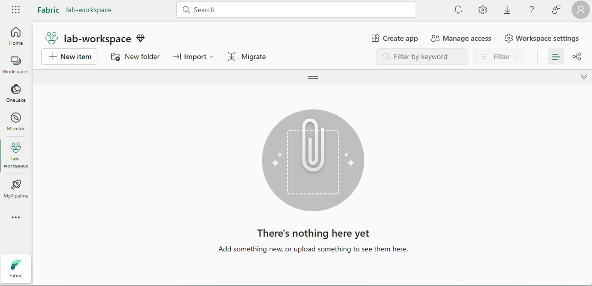

---
lab:
  title: Use Activator in Microsoft Fabric
  module: Use Activator in Microsoft Fabric
  description: In this lab, you'll learn how to use Activator in Microsoft Fabric to monitor real-time bicycle station readings and create alert rules that trigger actions based on data conditions. You'll explore sample data, define objects and properties, set up a rule with a street filter, and configure automated email notifications when stations have no empty docks.
  duration: 30 minutes
  level: 300
  islab: true
  primarytopics:
    - Microsoft Fabric
  categories:
    - Real-Time Intelligence
  courses:
    - DP-603
---

# Use Activator in Fabric

Activator in Microsoft Fabric takes action based on what's happening in your data. An Activator lets you monitor your data and create rules to react to your data changes.

This lab takes approximately **30** minutes to complete.

## Scenario

In this scenario, you're a data analyst for a shared bicycle service. You're responsible for monitoring bicycle stations across all available streets. Riders need both bicycles to hire and empty docks where they can return bicycles. You want to create an alert that emails the operations team when a station on Arlington Street has no empty docks, so the team can redistribute bicycles. The Activator sample already contains similar rules with email and Teams notifications. You'll explore a sample rule, then create your own object and a street-specific alert. For this lab, you'll send notifications to yourself rather than to an operations team.

## Create a workspace

> **Note**: You need access to a Fabric paid or trial capacity to complete this exercise. For information about the free Fabric trial, see [Fabric trial](https://aka.ms/fabrictrial).

1. Navigate to the [Microsoft Fabric home page](https://app.fabric.microsoft.com/home?experience=fabric-developer) at `https://app.fabric.microsoft.com/home?experience=fabric-developer` in a browser, and sign in with your Fabric credentials.
1. In the menu bar on the left, select **Workspaces** (the icon looks similar to &#128455;).
1. Create a new workspace with a name of your choice, selecting a licensing mode that includes Fabric capacity (*Trial*, *Premium*, or *Fabric*).
1. When your new workspace opens, it should be empty.

    

In this lab, you'll use the bicycle-sharing sample provided by Activator to explore a real-time data stream and create a rule that sends a notification when a condition is met.

> **Note**: The Activator sample process generates some random data in the background. The more complex your conditions and filters are, the more time it takes to trigger them. If you don't see any data in the graph, wait a few minutes and refresh the page. That said, you don't need to wait for the data to be displayed in the graphs to continue with the lab.

## Create an Activator

Next, create an Activator in the workspace you created:

1. On the menu bar on the left, select **Create**. In the *New* page, under the *Real-Time Intelligence* section, select **Activator**.

    >**Note**: If the **Create** option is not pinned to the sidebar, you need to select the ellipsis (**...**) option first.

1. Select the dropdown beside the current Activator name in the upper-left corner and change the name to ***Bikes Management Activator***.
1. Select **Try sample** and follow the guided prompts to enable the sample data.

Your Activator is now populated with sample objects, properties, and rules. In a production environment, you would connect your own data instead.

## Get familiar with the Activator home screen

Let's explore the eventstream data this sample is built on.

1. In the **Explorer** pane, scroll down and select the **Bicycle readings** stream.

    These events show real-time readings from bicycle stations, also called *bikepoints*, across all available streets, including the numbers of bicycles and empty docks.

1. Review the data in the **Event details** live table. Each data point contains information about incoming events. You might have to scroll to see it all.

    Find the following fields, which you'll use later in the lab:

    | Field | Meaning |
    | --- | --- |
    | **BikepointID** | Unique identifier for a bicycle station. Multiple readings can belong to the same station. |
    | **No_Bikes** | Number of bicycles available at the station. |
    | **No_Empty_Docks** | Number of empty docks available for returning bicycles. |
    | **Street** | Street where the station is located. |

1. In the **Explorer** pane, select the **Station readings** object. Notice that its events are grouped by **BikepointID**. Objects use this identifier to associate incoming readings with the correct station, and expose properties that rules can monitor.
1. Under **No_Empty_Docks**, select the sample rule **No empty docks (Email)** or the corresponding Teams rule.
1. In the **Definition** pane, review how the rule works:
    - **Monitor** uses the **No_Empty_Docks** property from the incoming readings.
    - **Condition** checks whether the number of empty docks **Is less than** `1`.
    - **Property filter** shows any filters configured for the selected rule. The underlying sample contains stations across all available streets.
    - **Action** sends an email or Teams message, depending on the selected rule.

    > **Note**: **No_Empty_Docks** less than `1` means there is nowhere to return a bicycle. **No_Bikes** less than `1` means there are no bicycles to hire. These are different operational problems.

1. Select the action type that you prefer, verify that you are the recipient, and then select **Send me a test action**. Check your email or Teams for the notification. The notification might take a minute or two to arrive.

    A test action checks notification delivery; it doesn't prove that a live reading satisfies the rule.

## Create an object

The sample already includes station objects. For this lab, create a separate object called *Bicycle stations* to practice assigning an identifier and selecting properties.

1. Select the **Bicycle readings** stream, and then select **New object** on the ribbon.

1. In the **Build object** pane to the right, enter the following values:
    - **Object name**: `Bicycle stations`
    - **Unique Identifier**: **BikepointID**
    - **Properties**: **No_Bikes**, **No_Empty_Docks**, **Street**

1. Select **Create**.

In the **Explorer** pane, a new object called **Bicycle stations** has been added, containing readings for stations across all available streets. You'll apply a street filter in the rule.

## Create a rule

Your rule should send an email when a station on **Arlington Street** has **no empty docks**. You'll monitor the dock count and add a property filter so that readings from other streets don't trigger the alert.

1. Select the **No_Empty_Docks** property within the *Bicycle stations* object and select **New rule** on the ribbon.
1. In the rule's **Definition** pane, enter the following values:
    - **Monitor**: **No_Empty_Docks**, without summarization
    - **Condition**: **Numeric state** > **Is less than**
    - **Value**: `1`
    - **Occurrence**: Every time the condition is met
    - **Action**: Send email

    If your interface first displays a **Create rule** pane, enter the condition and email action there, then select **Create** (not **Create and Start**) to open the full definition before starting the rule.

1. Save the rule with **Save** (or **Create**, if shown). Change its name to ***Arlington Street - no empty docks*** by selecting the pencil icon next to the rule's name in the middle pane.

    **Is less than** checks each reading's current state. Unlike **Decreases below**, it doesn't require a previous reading above the threshold.

1. In the **Definition** pane, expand **Property filter** and select **Add filter** if needed.
1. Set **Attribute** to **Street**, **Operation** to **Is equal to**, and **Value** to `Arlington Street`. Use the value shown in the incoming readings.

    No additional filter is needed: the street filter identifies the stations to monitor, and the numeric condition detects the lack of empty docks. Both must be satisfied for the rule to activate.

1. In the **Action** section, enter the following values:
    - **Select action**: Send email
    - **To**: Your current user account only.
    - **Subject**: *Arlington Street bicycle station has no empty docks*
    - **Headline**: *Redistribute bicycles to free up docks*
    - **Message**: *A station on Arlington Street has no empty docks for bicycle returns. Please check the station and arrange redistribution.*
    - **Context**: Select **Street**, **No_Empty_Docks**, and **No_Bikes**. Include **BikepointID** if it is available in the context list, so the operations team can identify the station.

1. Select **Save**, then **Send me a test action**. Verify that the email arrives and includes your configured content.
1. Select **Save and start**, or **Start** on the ribbon if the changes are already saved.

    You have now started your rule. It sends an email for each incoming reading that has **No_Empty_Docks** less than `1` and **Street** equal to **Arlington Street**. Repeated qualifying readings can produce repeated emails.

1. Inspect incoming readings and the rule's **History** tab for live activations. If you receive a live notification, check that its street and empty-dock count match the rule. If no qualifying readings arrive during the lab, the rule might not activate; a successful test email verifies delivery only. Don't remove the filter or change the condition just to force an alert.
1. When you've finished observing the rule, select **Stop** on the ribbon.

    As an optional extension, create a second rule on **No_Bikes** with **Is less than** `1` and the same street filter. Give it a distinct name and message asking the operations team to replenish bicycles. This monitors bicycle availability rather than return capacity. Test it, then stop it when you're finished.

## Clean up resources

In this exercise, you have created an Activator with an alert rule. You should now be familiar with the Activator interface and how to create objects, properties, and rules.

Stop any rules you started, including sample rules and the optional extension, to avoid further notifications and background processing. If you've finished exploring your Activator, delete the workspace you created for this exercise. Don't delete a shared workspace.

1. In the left navigation bar, select the icon for your workspace to view all of the items it contains.
2. In the menu on the top toolbar, select **Workspace settings**.
3. In the **General** section, select **Remove this workspace**.

## Learn more

- [Activator tutorial using the current bicycle sample](https://learn.microsoft.com/en-us/fabric/real-time-intelligence/data-activator/activator-tutorial)
- [Detection settings: conditions, occurrences, and property filters](https://learn.microsoft.com/en-us/fabric/real-time-intelligence/data-activator/activator-detection-conditions)
