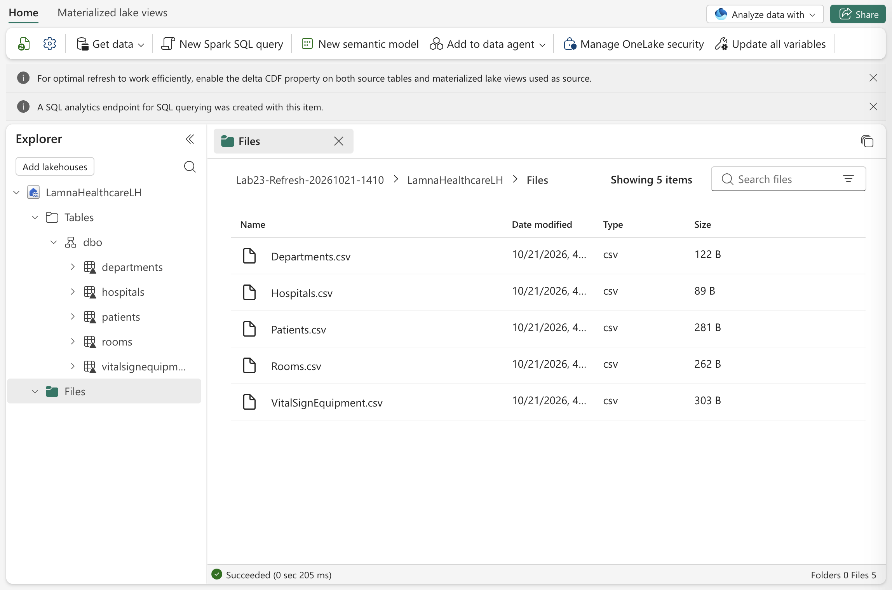
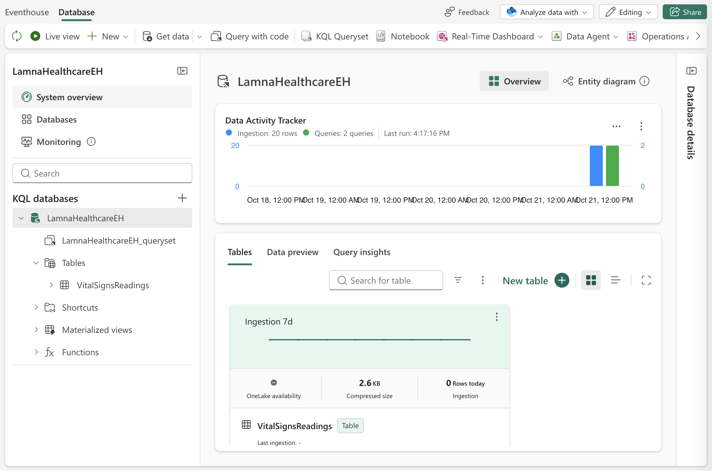
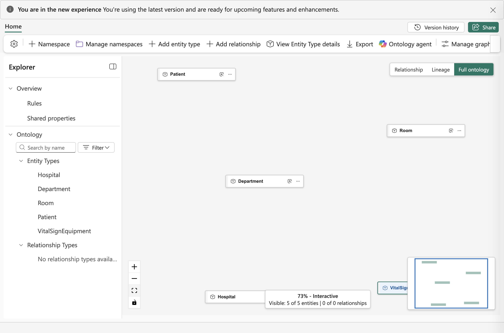
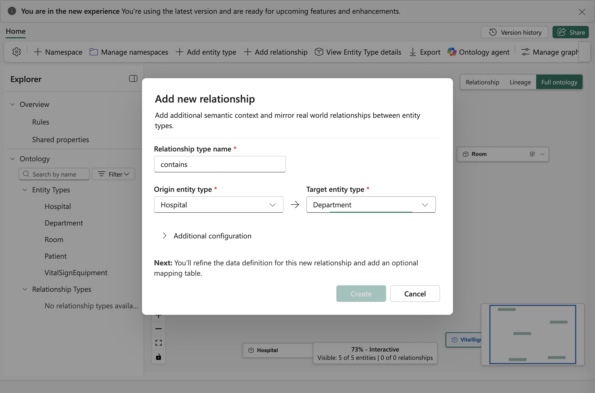
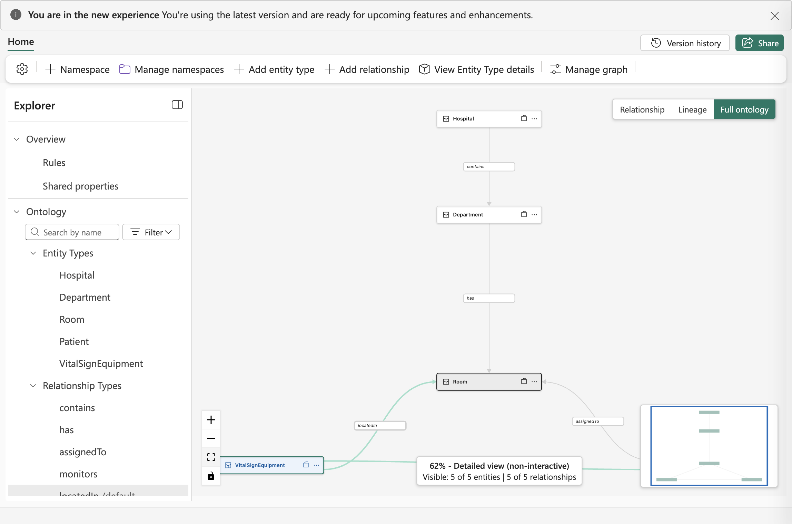
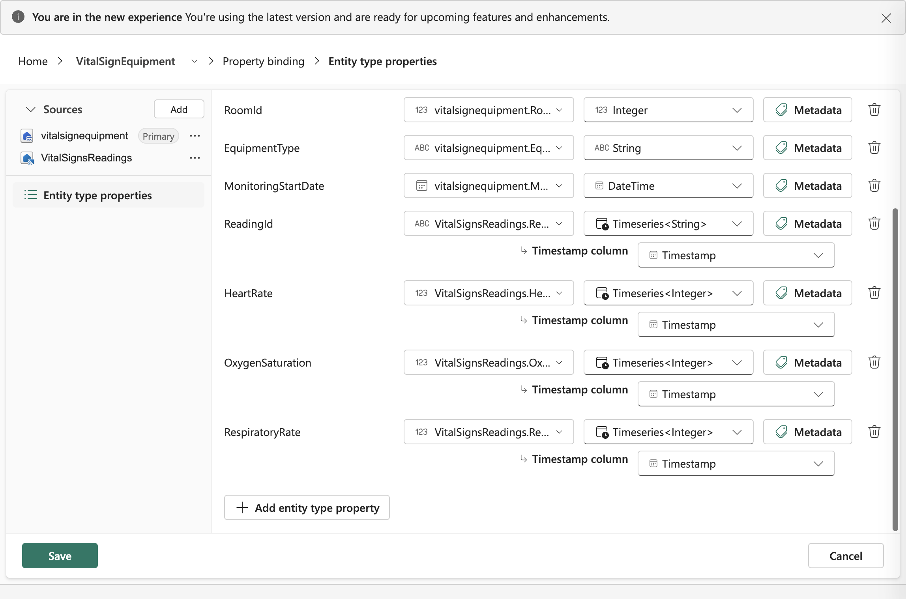
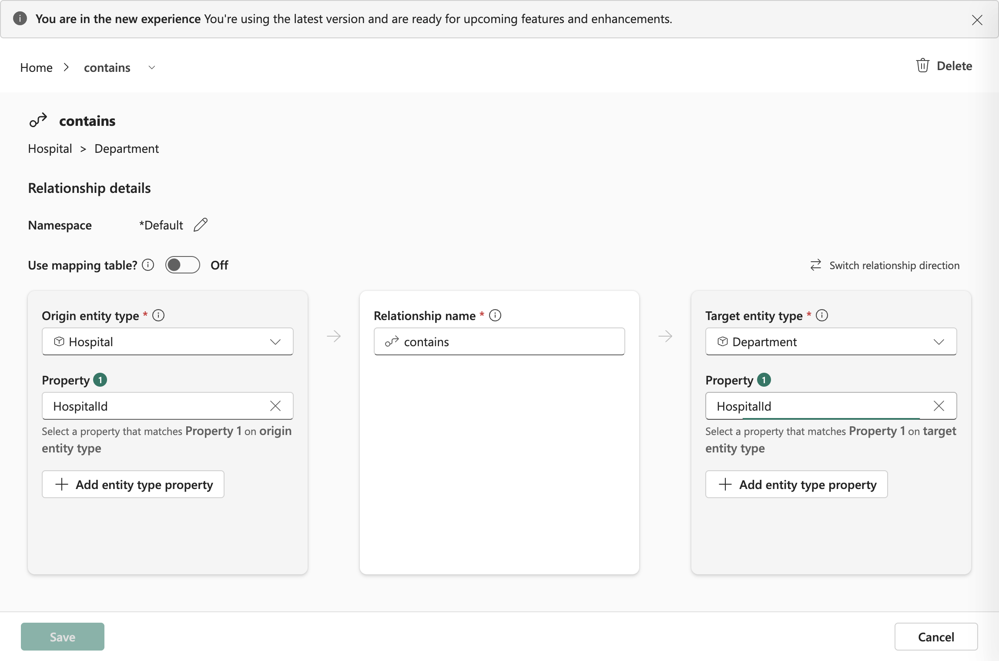
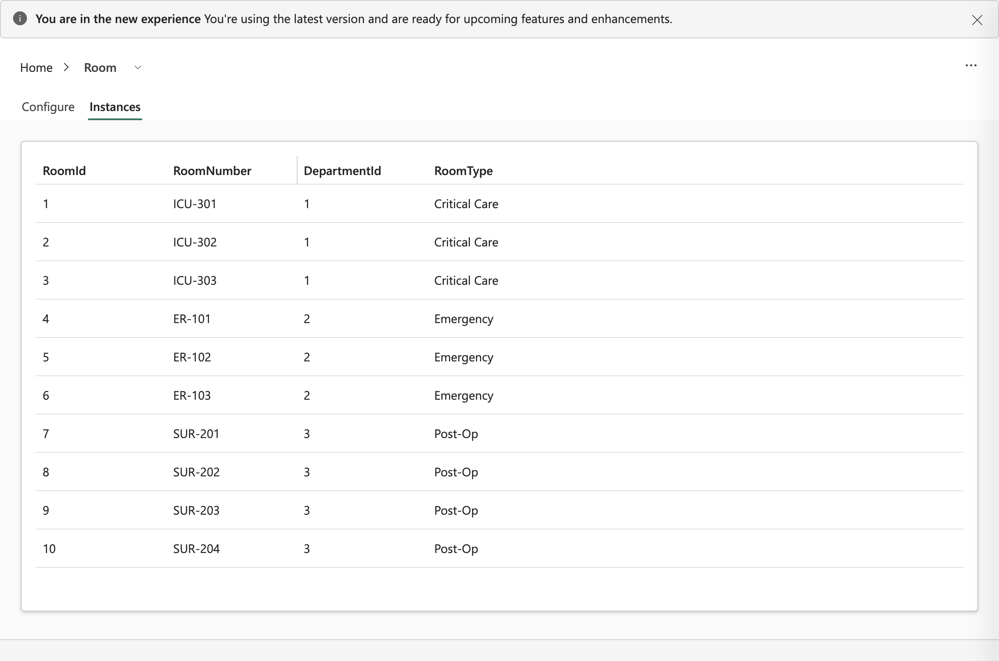

---
lab:
  title: Create an ontology with Fabric IQ
  module: Create ontology with Microsoft Fabric IQ
  description: "In this lab, you'll manually build a Fabric IQ ontology by creating entity types with properties and keys, defining relationships, and binding data from lakehouse and eventhouse tables. You'll work with static and time-series sample data to model hospitals, departments, patients, and vital sign monitoring equipment."
  duration: 40 minutes
  level: 200
  islab: true
  primarytopics:
    - Microsoft Fabric
  categories:
    - Get started with Fabric
    - Fabric IQ
  courses:
---

# Create an ontology with Fabric IQ

In this lab, you'll create a complete Fabric IQ ontology for a fictitious healthcare company by manually building each component—entity types, properties, keys, relationships, and data bindings. The sample data represents hospitals, departments, rooms, patients, vital sign equipment, and vital signs readings.

> [!IMPORTANT]
> Ontology in Microsoft Fabric is currently in [preview](https://learn.microsoft.com/fabric/fundamentals/preview).

This lab takes approximately **40** minutes to complete.

> **Note**: You need access to a Fabric paid or trial capacity and permission to create items in a workspace to complete this exercise. For information about the free Fabric trial, see [Fabric trial](https://aka.ms/fabrictrial). Ask your Fabric administrator to enable the required [tenant settings](https://learn.microsoft.com/fabric/iq/ontology/overview-tenant-settings): **Users can create ontology (preview) items** and **Users can create Fabric items**. This exercise uses the new ontology experience. It doesn't require you to materialize a graph.

## Create a workspace

1. Navigate to the [Microsoft Fabric home page](https://app.fabric.microsoft.com/home?experience=fabric) at `https://app.fabric.microsoft.com/home?experience=fabric` in a browser, and sign in with your Fabric credentials.
1. In the menu bar on the left, select **Workspaces** (the icon looks similar to &#128455;).
1. Create a new workspace with a name of your choice. Under **Advanced**, select **Fabric** and a capacity you can use, or select **Fabric Trial** if a trial capacity is available. Select **Apply**.
1. When your new workspace opens, it should be empty.

## Create a lakehouse with sample data

Now you'll create a lakehouse and load hospital operations data that will form the basis of your ontology.

1. In your workspace, select **+ New item** > **Lakehouse**.
1. Name the lakehouse `LamnaHealthcareLH`, leave **Lakehouse schemas** selected, and select **Create**.
1. When the lakehouse opens, you'll upload CSV files and convert them to tables.

### Download and load the hospital data files

You'll download sample data files, upload them to the lakehouse, and convert them to tables.

1. Download [sample-data.zip](https://github.com/MicrosoftLearning/mslearn-fabric/raw/main/Allfiles/Labs/23-24/sample-data.zip) and extract the CSV files to your local computer. The ZIP file contains:
   - **Hospitals.csv** - Healthcare facilities in your network
   - **Departments.csv** - Hospital departments (ICU, Emergency, Surgical)
   - **Rooms.csv** - Individual rooms within departments
   - **Patients.csv** - Current patients and their room assignments
   - **VitalSignEquipment.csv** - Monitoring equipment assigned to patients (which patient is being monitored, and when monitoring started)
   - **VitalSignsReadings.csv** - Actual patient vital sign measurements (heart rate, oxygen levels) collected over time from the monitors

1. Upload the five lakehouse files:
   - In the lakehouse, select **Get data** > **Upload files**.
   - Browse to and select these five files: **Hospitals.csv**, **Departments.csv**, **Rooms.csv**, **Patients.csv**, **VitalSignEquipment.csv**
   - Select **Open**.
   - Select **Upload** to upload all five files at once.
   - Wait until each file shows that the upload is complete, then close the upload dialog.
   
   > **Note**: You'll upload VitalSignsReadings.csv to an eventhouse later, not to the lakehouse.

1. Convert each uploaded file to a table:
   - In **Explorer**, select the **Files** folder, where you should see all five CSV files
   - For each file, select the **ellipsis (...)** to the right of the file name
   - Select **Load to Tables** > **New table**
   - Configure the table:
     - **New table name**: Use the file name without extension in lowercase (for example, `hospitals`, `departments`, `rooms`, `patients`, `vitalsignequipment`)
     - **Column header**: Check **Use header for column names**
     - **Separator**: Leave as comma (`,`)
   - Select **Load** and wait for the success notification before you load the next file. **Load to Tables** is unavailable while another load is running.
   - Repeat this process for all five files.

1. Expand **Tables** > **dbo** and verify you have five tables: `hospitals`, `departments`, `rooms`, `patients`, and `vitalsignequipment`, as shown in the image below.

     

## Create an eventhouse with streaming data

Next, you'll create an eventhouse to store timestamped vital signs data that you'll bind to the ontology later. You ingest a fixed sample file in this exercise, not a live stream.

> **Note**: To return to your workspace from an open item, select the workspace in the left navigation, then select its name in the object explorer. Dismiss any first-use welcome dialogs or tours to access the item controls.

1. In your workspace, select **+ New item** > **Eventhouse**.
1. Name the eventhouse `LamnaHealthcareEH` and select **Create**.
1. A default KQL database is created with the same name. Select the KQL database to open it.

### Ingest vital signs data

1. In the KQL database, select **Get data** > **Local file**.
1. In the **Select or create a destination table** section, select **New table**, enter `VitalSignsReadings`, and select the check mark to submit the name.
1. Under **Add up to 1,000 files**, select **Browse for files** and upload the VitalSignsReadings.csv file you downloaded earlier.
1. Select **Next**. On the inspection page, verify that **First row header** is selected and that the preview shows six named columns, including **EquipmentId** and **Timestamp**.
1. Select **Finish**. Wait for the summary to show **Successfully ingested**, then select **Close**.
1. Verify the **VitalSignsReadings** table appears in the KQL database and that the ingestion summary reports **20 rows**.

   Your KQL database should now show the VitalSignsReadings table:

   

## Create an ontology

Now you'll create an empty ontology and build it step by step.

1. In your workspace, select **+ New item** > **Ontology (preview)**.
1. Name the ontology `LamnaHealthcareOntology` and select **Create**.
1. The ontology canvas opens, empty and ready for you to build your data model.

## Create entity types

You'll create five entity types representing the healthcare domain. Follow the detailed steps for the first entity type to learn the process, then use the reference table to create the remaining four.

### Create Hospital entity type

1. In the ontology ribbon, select **Add entity type**.
1. Enter **Hospital** as the entity type name and select **Add Entity Type**.
1. The Hospital entity type appears on the canvas.
1. With the Hospital entity type selected, select **View entity type details** in the ribbon to open the entity type's **Configure** page.
1. In the **Properties** section, expand **Manage property bindings** and select **Add properties**.
1. Enter the first property name and data type below. Select **+ Add** to add a row for each remaining property:

   | Property Name | Property Type |
   |---------------|-----------|
   | HospitalId | Integer  |
   | HospitalName | String |
   | City | String |
   | State | String |

1. After adding all properties, select **Save**.

1. Now you need to define an entity key. An entity key is a property that uniquely identifies each instance of the entity type. For hospitals, each hospital has a unique HospitalId, so this will be the key.
   
   Select **Define entity type key** and choose **HospitalId** as the key, select **Save**.

1. Select **Home** to return to the ontology canvas.

### Create remaining entity types

Follow the same process to create these four additional entity types with their properties and keys:

| Entity Type | Property Name | Property Type | Entity Type Key |
|-------------|---------------|-----------|-----------------|
| **Department** | `DepartmentId`<br>`DepartmentName`<br>`HospitalId`<br>`Floor` | Integer<br>String<br>Integer<br>Integer | DepartmentId |
| **Room** | `RoomId`<br>`RoomNumber`<br>`DepartmentId`<br>`RoomType` | Integer<br>String<br>Integer<br>String |  RoomId |
| **Patient** | `PatientId`<br>`FirstName`<br>`LastName`<br>`DateOfBirth`<br>`AdmissionDate`<br>`CurrentRoomId` | Integer<br>String<br>String<br>DateTime<br>DateTime<br>Integer |  PatientId |
| **VitalSignEquipment** | `EquipmentId`<br>`PatientId`<br>`RoomId`<br>`EquipmentType`<br>`MonitoringStartDate` | String<br>Integer<br>Integer<br>String<br>DateTime | EquipmentId |

You now have five entity types with properties and keys defined.  Verify that the Entity Types pane shows all five entity types, and that properties and entity type key have been defined for each entity:

   

## Create relationship types

Now, you'll create relationship types that model the healthcare entity relationships and vital sign monitoring: Hospital → Department → Room → Patient, with VitalSignEquipment monitoring Patient and located in Room. Follow the detailed steps for the first relationship, then use the reference table to create the remaining four.

### Create Hospital-Department relationship

1. In the ribbon, select **Add relationship**.
1. In the **Add new relationship** dialog, configure:
   - **Relationship type name**: `contains`
   - **Origin entity type**: `Hospital`
   - **Target entity type**: `Department`
1. Select **Create**.

   

The Contains relationship line appears on the canvas connecting Hospital to Department. You'll configure the data source later.

### Create remaining relationships

Follow the same process to create these four additional relationships:

| Relationship Name | Origin Entity Type | Target Entity Type | Meaning |
|-------------------|-------------------|-------------------|---------|
| **has** | Department | Room | Departments have rooms |
| **assignedTo** | Patient | Room | Patients are assigned to rooms |
| **monitors** | VitalSignEquipment | Patient | Vital sign equipment monitors patients |
| **locatedIn** | VitalSignEquipment | Room | Vital sign equipment is located in rooms |

   Your ontology canvas should look similar to the image below. Depending on canvas layout and which entities are selected, you may need to pan or zoom to view all entity types and relationship lines.

   

Your ontology structure is complete. Now you need to bind entity properties to actual data sources.

## Bind entity types to data

So far, you've defined the schema of your ontology—entity types with properties and keys—but these are just empty templates. To make the ontology functional, you must bind each entity type to actual data sources. This tells Fabric where to find the real healthcare data that will populate your ontology.

You'll bind static data from lakehouse tables to four entities, then add both static and time-series bindings to the VitalSignEquipment entity.

### Bind Hospital entity

1. Select **Hospital** in **Explorer**, then select **View Entity Type details**.
1. On the **Configure** page, select **Manage property bindings** > **Add binding and properties**.
1. On the **Property binding** page, select **Add** next to **Sources** to open the OneLake catalog.
1. Find **LamnaHealthcareLH** in your workspace. Expand the lakehouse, expand **dbo**, select **hospitals**, and select **Select table**.
1. Select **Entity type properties** and wait for the source columns to populate. Verify these mappings to the existing properties:

   | Property | Source column | Property type |
   |----------|---------------|---------------|
   | HospitalId | hospitals.HospitalId | Integer |
   | HospitalName | hospitals.HospitalName | String |
   | City | hospitals.City | String |
   | State | hospitals.State | String |

   If a mapping isn't populated, select the existing property name and its matching source column. Don't create duplicate properties or add an empty property row.

1. Select **Create**, wait for **Entity type updated successfully**, then select **Cancel** to close the binding page. On **Configure**, verify that the properties show their source columns rather than **Unbound**.
1. Select **Home** to return to the ontology canvas.

### Bind Department, Room, and Patient entities

Follow the same binding process for these three entities, which only require static data bindings. Select each table under **LamnaHealthcareLH** > **dbo**. Verify that each property maps to the source column of the same name and retains the data type you defined earlier.

| Entity Type | Table Name | Source Columns |
|-------------|------------|----------------|
| **Department** | departments | `DepartmentId`<br>`DepartmentName`<br>`HospitalId`<br>`Floor` |
| **Room** | rooms | `RoomId`<br>`RoomNumber`<br>`DepartmentId`<br>`RoomType` |
| **Patient** | patients | `PatientId`<br>`FirstName`<br>`LastName`<br>`DateOfBirth`<br>`AdmissionDate`<br>`CurrentRoomId` |

### Bind VitalSignEquipment entity

The VitalSignEquipment entity uses two data sources: a primary source for static equipment attributes and a secondary source for time-series measurements. Bind the static source first, then link the readings by EquipmentId:

**VitalSignEquipment.csv** (Lakehouse - Static attributes):
```text
EquipmentId | PatientId | RoomId | EquipmentType         | MonitoringStartDate
VS-1001     | 1001      | 1      | Continuous Monitoring | 2026-02-01
VS-1002     | 1002      | 2      | Continuous Monitoring | 2026-02-01
```

**VitalSignsReadings.csv** (Eventhouse - Time-series measurements):
```text
ReadingId | EquipmentId | Timestamp            | HeartRate | OxygenSaturation | RespiratoryRate
1         | VS-1001     | 2026-02-02T08:00:00Z | 78        | 98               | 16
2         | VS-1001     | 2026-02-02T08:05:00Z | 82        | 97               | 18
4         | VS-1002     | 2026-02-02T08:00:00Z | 92        | 99               | 14
```

Notice the time-series data only has measurements and EquipmentId—not patient or equipment type. The static binding creates the equipment entities with full context (VS-1001 is Continuous Monitoring equipment tracking Patient 1001), and the time-series binding attaches streaming measurements to those entities using EquipmentId as the matching key.

#### Bind static monitor reference data

1. Select **VitalSignEquipment** in **Explorer**, then select **View Entity Type details**.
1. Select **Manage property bindings** > **Add binding and properties**, then select **Add** next to **Sources**.
1. Expand **LamnaHealthcareLH** > **dbo**, select **vitalsignequipment**, and select **Select table**.
1. Select **Entity type properties**, wait for the columns to populate, and verify the mappings:
   - EquipmentId → EquipmentId
   - PatientId → PatientId
   - EquipmentType → EquipmentType
   - MonitoringStartDate → MonitoringStartDate
   - RoomId → RoomId
1. Select **Create**, wait for **Entity type updated successfully**, and select **Cancel** to return to **Configure**.

#### Bind time-series vital signs data

Now you'll add the timestamped readings as time-series properties.

1. On the **VitalSignEquipment** **Configure** page, select **Manage property bindings** > **Add binding and properties**.
1. Select **Add** next to **Sources**. In the OneLake catalog, expand **LamnaHealthcareEH**, expand its **LamnaHealthcareEH** KQL database, select **VitalSignsReadings**, and select **Select table**. Use the keyword filter if needed to find the eventhouse.
1. Under **Relationship with primary data source**, select **EquipmentId** in both the **vitalsignequipment column** and **VitalSignsReadings column** lists. Select **Save**.
1. Select **Entity type properties**. Keep the five existing static properties bound to **vitalsignequipment**, including the **EquipmentId** key.
1. Verify the new properties and their time-series configuration:

   | Property | Source column | Property type | Timestamp column |
   |----------|---------------|---------------|------------------|
   | ReadingId | VitalSignsReadings.ReadingId | Timeseries&lt;String&gt; | Timestamp |
   | HeartRate | VitalSignsReadings.HeartRate | Timeseries&lt;Integer&gt; | Timestamp |
   | OxygenSaturation | VitalSignsReadings.OxygenSaturation | Timeseries&lt;Integer&gt; | Timestamp |
   | RespiratoryRate | VitalSignsReadings.RespiratoryRate | Timeseries&lt;Integer&gt; | Timestamp |

   Keep the inferred **String** value type for **ReadingId**. **Timestamp** orders each time-series property rather than becoming a separate static property. If duplicate key columns are proposed, keep the original **EquipmentId** property bound to the primary source instead of adding another equipment key.

   Your time-series binding configuration should look like this:

   

1. Select **Save**, wait for **Entity type updated successfully**, and select **Cancel**. On **Configure**, verify that the new properties show **Timeseries** and the **VitalSignsReadings** source.
1. Select **Home** to return to the ontology canvas.

Your VitalSignEquipment entity now has both static reference data (which monitors are where) and time-series data (sample vital sign readings over time).

All five entity types now have data bindings connecting their properties to data sources.

## Configure relationships

Now you'll configure each relationship type by matching properties in the two bound entity types. The sample tables already contain the properties needed for these joins, so you don't need a separate mapping table.

### Configure Hospital-Department relationship

1. In **Explorer**, under **Relationship Types**, select **contains** to open its configuration page.
1. Leave **Use mapping table?** set to **Off**.
1. Under **Origin entity type**, confirm **Hospital** is selected and set **Property 1** to **HospitalId**.
1. Under **Target entity type**, confirm **Department** is selected and set **Property 1** to **HospitalId**.

   These selections match `Hospital.HospitalId` to `Department.HospitalId`. Don't match HospitalId to DepartmentId: the department's HospitalId identifies its parent hospital.

   Your **contains** configuration should look like this:

   

1. Select **Save** and wait for **Successfully updated the relationship type**.
1. Select **Home** to return to the ontology canvas.

### Configure remaining relationships

Follow the same process for the remaining four relationships. Select each relationship under **Relationship Types**, leave **Use mapping table?** set to **Off**, select the properties below, and select **Save**. Wait for the success message before you return **Home**.

| Relationship | Origin entity property | Target entity property |
|--------------|------------------------|------------------------|
| **has** (Department → Room) | Department.DepartmentId | Room.DepartmentId |
| **assignedTo** (Patient → Room) | Patient.CurrentRoomId | Room.RoomId |
| **monitors** (VitalSignEquipment → Patient) | VitalSignEquipment.PatientId | Patient.PatientId |
| **locatedIn** (VitalSignEquipment → Room) | VitalSignEquipment.RoomId | Room.RoomId |

The equipment-to-room relationship uses the equipment table's RoomId directly. PatientId identifies a patient, not a piece of equipment, and isn't the equipment entity key.

## Preview the ontology

Your ontology now has entities, relationships, static data, and time-series properties.

1. Select **Room** under **Entity Types**, then select **View Entity Type details**.
1. Select the **Instances** tab and wait for the data to load. Verify that the table contains 10 rooms.
1. Find **ICU-302**. Verify that its **RoomId** is **2**, **DepartmentId** is **1**, and **RoomType** is **Critical Care**.

   

1. Return **Home** and use the same process to inspect the other entity types. The sample contains one hospital, three departments, five patients, and five pieces of vital sign equipment.
1. Open **VitalSignEquipment** > **Configure**. Verify that **EquipmentId** remains the entity key, **RoomId** is bound to **vitalsignequipment.RoomId**, and **ReadingId**, **HeartRate**, **OxygenSaturation**, and **RespiratoryRate** show **Timeseries** bindings to **VitalSignsReadings**. The **Instances** table displays the static equipment properties, not the time-series readings.
1. Return **Home** and verify that all five relationship types are listed. Reopen each relationship to check the saved property pairs against the preceding table.

You've manually defined a healthcare ontology and connected its business concepts to sample operational data. The new experience uses **Configure** and **Instances** rather than the old **Entity type overview** tiles. Exploring a materialized graph or creating an AI agent is outside this exercise. For an optional next step, see [Materialize a graph from an ontology](https://learn.microsoft.com/fabric/iq/ontology/how-to-use-ontology-graph).

## Clean up resources (optional)

You can keep this workspace and ontology to continue exploring Fabric IQ capabilities. If you want to remove the resources you created in this exercise, follow these steps:

1. In the bar on the left, select your workspace, then select its name in the object explorer to open the workspace page.
1. Select **Workspace settings**.
1. In the **General** section, select **Remove this workspace**. Confirm that the dialog names the workspace you created for this exercise, then confirm its removal. This removes the lakehouse, eventhouse, ontology, and any items created automatically for the ontology. Don't remove a shared workspace.
