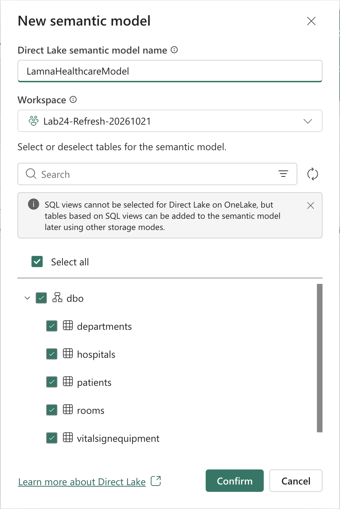
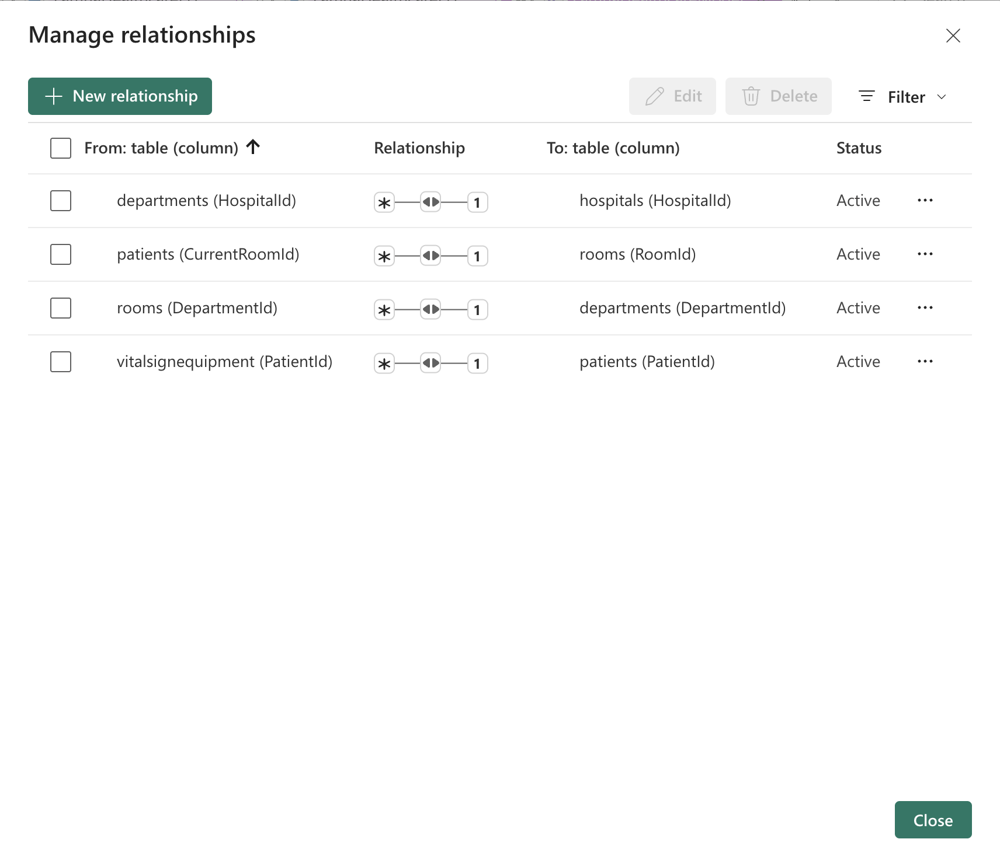
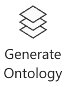
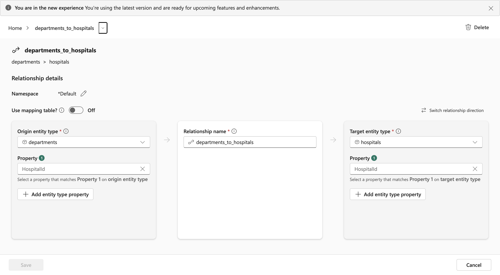
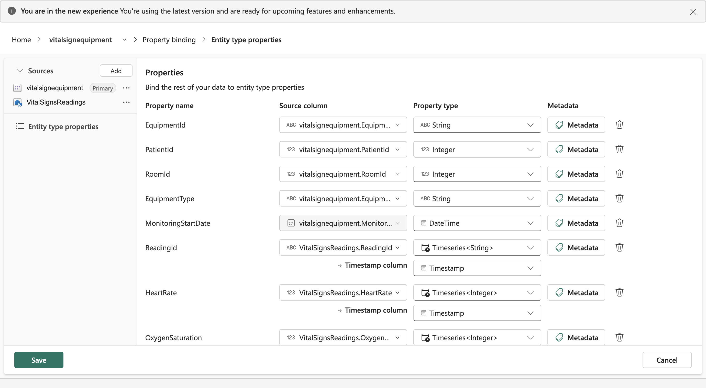
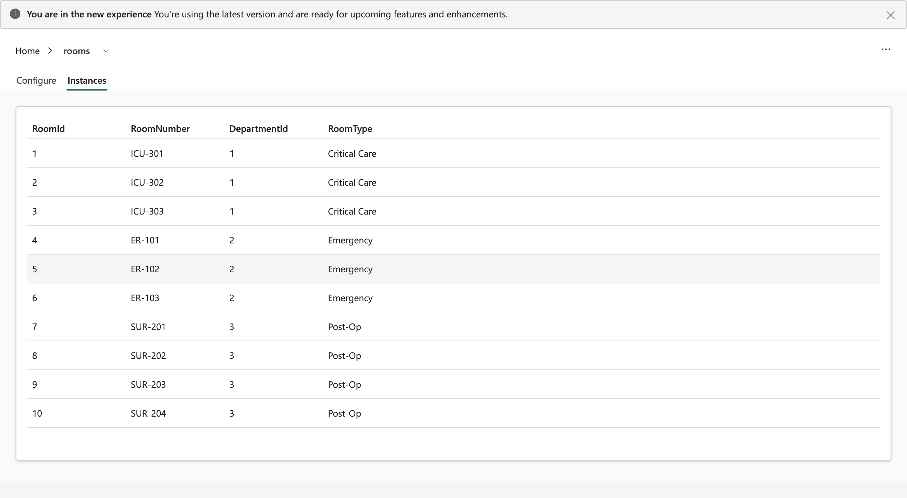

---
lab:
  title: Build an ontology from a semantic model in Fabric IQ
  module: Create ontology with Microsoft Fabric IQ
  description: 'In this lab, you generate a Fabric IQ ontology from a Power BI semantic model using healthcare data, configure entity types and relationships with data bindings, and combine static data from a lakehouse with time-series data from an eventhouse.'
  duration: 45 minutes
  level: 200
  islab: true
  primarytopics:
    - Microsoft Fabric
  categories:
    - Fabric IQ
  courses:
    - DP-600
---

# Build an ontology from a semantic model in Fabric IQ

There are two ways to build a Fabric IQ ontology: manually, by creating each entity type and relationship from scratch, or automatically, by generating the structure from a Power BI semantic model. This lab uses the semantic model approach.

In this lab, you'll load sample data for a fictitious healthcare company into a lakehouse and eventhouse, build a semantic model on top of it, and then generate an ontology from that model. The sample data represents hospitals, departments, rooms, patients, vital sign equipment, and vital signs readings. Each table in the semantic model becomes an entity type, and each relationship between tables becomes a relationship type in the ontology.

> [!IMPORTANT]
> Ontology in Microsoft Fabric is currently in [preview](https://learn.microsoft.com/fabric/fundamentals/preview).
> This exercise uses the **new ontology experience**. The controls differ from the old experience.

This lab takes approximately **45** minutes to complete.

> **Tip:** For related training content, see [Create an ontology in Microsoft Fabric](https://learn.microsoft.com/training/modules/create-ontology-with-fabric-iq/).

> **Note**: You need a workspace on a Fabric-enabled paid or trial capacity and permission to create items in it. For information about the free Fabric trial, see [Fabric trial](https://aka.ms/fabrictrial). Ask your administrator to enable these [tenant settings](https://learn.microsoft.com/fabric/iq/ontology/overview-tenant-settings) for your account: **Users can create Fabric items** and **Users can create ontology (preview) items**. Generating an ontology also requires **Read** and **Build** permissions on the semantic model; creating the model in this exercise provides those permissions.

## Create a workspace

1. Navigate to the [Microsoft Fabric home page](https://app.fabric.microsoft.com/home?experience=fabric) at `https://app.fabric.microsoft.com/home?experience=fabric` in a browser, and sign in with your Fabric credentials.
1. In the menu bar on the left, select **Workspaces** (the icon looks similar to &#128455;).
1. Create a new workspace with a name of your choice. In **Advanced**, select **Fabric** or **Fabric Trial**, using an available Fabric-enabled capacity.
1. When your new workspace opens, it should be empty.

## Create a lakehouse with sample data  

Now you'll create a lakehouse and load hospital operations data that will form the basis of your ontology.

1. In your workspace, select **+ New item** > **Lakehouse**.
1. Name the lakehouse `LamnaHealthcareLH`, leave **Lakehouse schemas** enabled, and select **Create**.
1. When the lakehouse opens, you'll upload CSV files and convert them to tables.

### Download and load the hospital data files

You'll download sample CSV files, upload them to the lakehouse, and convert them to tables.

1. Download [sample-data.zip](https://github.com/MicrosoftLearning/mslearn-fabric/raw/main/Allfiles/Labs/23-24/sample-data.zip) and extract the CSV files to your local computer. The ZIP file contains:
   - **Hospitals.csv** - Healthcare facilities in your network
   - **Departments.csv** - Hospital departments (ICU, Emergency, Surgical)
   - **Rooms.csv** - Individual rooms within departments
   - **Patients.csv** - Current patients and their room assignments
   - **VitalSignEquipment.csv** - Monitoring equipment assigned to patients (which patient is being monitored, and when monitoring started)
   - **VitalSignsReadings.csv** - Patient vital sign measurements (heart rate, oxygen levels, respiratory rate) collected over time from the vital sign equipment

1. Upload the five lakehouse files:
   - In the lakehouse, select **Upload files** from the main view
   - Browse to and select these five files: **Hospitals.csv**, **Departments.csv**, **Rooms.csv**, **Patients.csv**, **VitalSignEquipment.csv**
   - Select **Open**
   - Select **Upload** to upload all five files at once
   - Wait for the upload to complete
   
   > **Note**: Do not upload **VitalSignsReadings.csv** to the lakehouse. You'll load it to the eventhouse in the next section, where it belongs as time-series data.

1. Convert each uploaded file to a table:
   - In **Explorer**, select the **Files** folder, where you should see all five CSV files
   - For each file, select the **ellipsis (...)** to the right of the file name
   - Select **Load to Tables** > **New table**
   - Configure the table:
     - **Schema**: Select **dbo**.
     - **Table name**: Enter the corresponding lowercase name: `hospitals`, `departments`, `rooms`, `patients`, or `vitalsignequipment`. The field might be blank; don't assume Fabric fills it in.
     - **Column header**: Check **Use header for column names**
     - **Separator**: Leave as comma (`,`)
   - Select **Load**
   - Repeat this process for all five files

1. Expand **Tables** > **dbo** and verify you have five tables: `hospitals`, `departments`, `rooms`, `patients`, and `vitalsignequipment`.

## Create an eventhouse with time-series data

Next, you'll create an eventhouse to store vital signs readings for the equipment entities. These readings are a fixed historical sample from February 2, 2026. This exercise ingests a CSV file once; it doesn't configure a live stream.

1. In your workspace, select **+ New item** > **Eventhouse**.
1. Name the eventhouse `LamnaHealthcareEH` and select **Create**.
1. A default KQL database is created with the same name. Select the KQL database to open it.

### Ingest vital signs data

1. Select the KQL database `LamnaHealthcareEH`, then select **Get data** > **Local file**.
1. In the **Select or create a destination table** section, select **+ New table** and enter `VitalSignsReadings` as the table name.
1. Under **Add up to 1,000 files**, select **Browse for files** and upload the **VitalSignsReadings.csv** file you downloaded earlier.
1. Select **Next**. In the inspection step, verify that the format is **CSV** and the first row is treated as column names, not as data.
1. Check that **ReadingId** and **EquipmentId** are strings, **Timestamp** is datetime, and **HeartRate**, **OxygenSaturation**, and **RespiratoryRate** are numeric columns. Correct the inferred types if necessary.
1. Select **Finish** and wait for successful ingestion.
1. Open **Explore your data** or a query tab for the KQL database, run the following query, and verify the result is **20**:

   ```kusto
   VitalSignsReadings
   | count
   ```

## Create a semantic model

Now you'll create a Power BI semantic model from your lakehouse. As you define each relationship, think about what it means in the real world: a department *belongs to* a hospital, a room *is part of* a department, a patient *is admitted to* a room, and a piece of equipment *is assigned to* a patient. These business relationships are exactly what ends up in the ontology.

1. In your workspace, open the **LamnaHealthcareLH** lakehouse.

1. From the lakehouse ribbon, select **New semantic model**.

1. In the **New semantic model** dialog, as shown below:
   - In the **Direct Lake semantic model name** field, enter `LamnaHealthcareModel`.
   - Select all five tables: **hospitals**, **departments**, **rooms**, **patients**, **vitalsignequipment**.
   - Select **Confirm**.
   
   > **Note**: If the tables don't appear in the list, refresh your browser and try again.
   
   - The semantic model opens directly, showing your five tables.

   

### Define relationships between tables

Relationships in the semantic model define how tables connect to each other. These relationships become the relationship types in your ontology.

1. In the ribbon, select **Manage relationships** > **+ New relationship**.

2. Select the tables and their column headers to create the first relationship with these settings:
   - **From table**: departments | **Column**: HospitalId
   - **To table**: hospitals | **Column**: HospitalId
   - **Cardinality**: Many to one (\*:1)
   - **Cross filter direction**: Both
   - Ensure the relationship is **Active**, then select **Save**.

   > **Note**: Wait for **Determining relationship cardinality...** to finish before setting cardinality and cross-filter direction. Direct Lake data previews might be unavailable, and the detected cardinality might not match the relationship you need. Explicitly select **Many to one (\*:1)** and **Both**.

3. Select **+ New relationship** again and create three more relationships:

   | From table | From column | To table | To column |
   |---|---|---|---|
   | rooms | DepartmentId | departments | DepartmentId |
   | patients | CurrentRoomId | rooms | RoomId |
   | vitalsignequipment | PatientId | patients | PatientId |

   Use the same settings for each: cardinality **Many to one (\*:1)**, cross filter **Both**, and **Active**, then **Save**. For the patients-to-rooms relationship, explicitly select **CurrentRoomId** in patients and **RoomId** in rooms.

4. Verify your **Manage relationships** pane shows exactly 4 active relationships, matching the image below, then select **Close**.

   

## Generate the ontology

Now that your semantic model is ready and your lakehouse data is in place, you'll generate the ontology from the semantic model editor. The semantic model captures your static hospital data — hospitals, departments, rooms, patients, and vital sign equipment. The eventhouse vital signs readings data is time-series data, which is added to the ontology manually after generation.

1. With the semantic model editor still open, select **Generate Ontology** from the ribbon. If necessary, look in the ribbon's overflow menu.

   

1. If an introduction appears, select **Get started**.
1. In **New Ontology**, enter `LamnaHealthcareOntology`, select your workspace as the location, and select **Create**.
1. Wait for generation to finish and the ontology canvas to open.

The system generates **5 entity types** (`hospitals`, `departments`, `rooms`, `patients`, and `vitalsignequipment`) with their properties and **4 relationship types**. The static property bindings use the semantic model. The eventhouse readings aren't included yet.

Next, you'll define entity keys, verify the generated relationship mappings, and add the readings as a second property binding.

## Review and add entity type keys

Each entity type needs a key property that uniquely identifies each instance. Don't assume generation defines every key.

1. On the Home canvas, select **hospitals** in **Explorer**, then select **View Entity Type details**. Alternatively, use the entity's **Configure entity type** control on the canvas.
1. On the **Configure** tab, select **Entity type key**. If no key exists, the button displays **Define entity type key**.
1. In **Add or edit key**, open **Property list**, select **HospitalId**, close the list, and select **Save**.
1. Verify that **Entity type key** now displays **HospitalId**.
1. Use the drop-down arrow beside the entity name in the breadcrumb to switch entities. Define or verify these keys on each entity's **Configure** tab:

   | Entity type | Key property |
   |---|---|
   | departments | DepartmentId |
   | rooms | RoomId |
   | patients | PatientId |
   | vitalsignequipment | EquipmentId |

## Verify and configure relationship types

In the new experience, these generated relationships match a property on the origin entity to a property on the target entity. You don't need a separate mapping table for this model.

1. Open **departments** on the **Configure** tab.
1. Select **Manage relationships** > **departments_to_hospitals**.
1. In **Relationship details**, verify that **Use mapping table?** is **Off**, the origin entity is **departments** with property **HospitalId**, and the target entity is **hospitals** with property **HospitalId**.

   > **Note**: **DepartmentId** identifies a department instance, but **HospitalId** connects it to its hospital. The relationship matches `departments.HospitalId` to `hospitals.HospitalId`; it doesn't match the two entities' primary keys to each other.

   

1. If a value is missing or incorrect, set it and select **Save**. If the generated mapping is correct, no save is necessary.
1. Use the drop-down beside the relationship name in the breadcrumb to review the remaining relationships. Keep **Use mapping table?** **Off** and verify these mappings:

   | Relationship | Origin entity | Origin property | Target entity | Target property |
   |---|---|---|---|---|
   | rooms_to_departments | rooms | DepartmentId | departments | DepartmentId |
   | patients_to_rooms | patients | CurrentRoomId | rooms | RoomId |
   | vitalsignequipment_to_patients | vitalsignequipment | PatientId | patients | PatientId |

With all four relationships verified, your ontology represents the hospital, department, room, patient, and equipment connections.

## Add time-series binding to vitalsignequipment

The `vitalsignequipment` entity has five static properties: **EquipmentId**, **PatientId**, **RoomId**, **EquipmentType**, and **MonitoringStartDate**. Add a second source to attach the historical readings from your eventhouse.

1. Select **Home** in the breadcrumb. Open **vitalsignequipment** in the entity type details view.
1. On **Configure**, select **Manage property bindings** > **Add binding and properties**.
1. On **Property binding**, note the existing **vitalsignequipment** source marked **Primary**, then select **Add** under **Sources**.
1. In the OneLake catalog, locate **LamnaHealthcareEH** in your workspace. Expand the **Eventhouse**, then its **KQL Database**, to display the tables.
1. Select **VitalSignsReadings**, then select **Select table**.
1. Under **Relationship with primary data source**, select **EquipmentId** for both **vitalsignequipment column** and **VitalSignsReadings column**.
1. Select **Save** and wait for saving to finish.

   > **Note**: The shared **EquipmentId** links each reading to an existing equipment entity. Keep **vitalsignequipment** as the primary source; adding readings doesn't create a new entity type.

1. Select **Entity type properties** in the left pane. Review the proposed properties:

   | Property | Source column | Property type | Timestamp column |
   |---|---|---|---|
   | ReadingId | VitalSignsReadings.ReadingId | Timeseries&lt;String&gt; | Timestamp |
   | HeartRate | VitalSignsReadings.HeartRate | Timeseries&lt;Integer&gt; | Timestamp |
   | OxygenSaturation | VitalSignsReadings.OxygenSaturation | Timeseries&lt;Integer&gt; | Timestamp |
   | RespiratoryRate | VitalSignsReadings.RespiratoryRate | Timeseries&lt;Integer&gt; | Timestamp |

   Verify that each time-series property uses **Timestamp** as its timestamp column. **Timestamp** provides the time axis rather than a separate measurement property. Keep the five existing static properties and their primary-source mappings.

   

1. Select **Save** and wait for saving to finish. Then select **Cancel** to leave the binding editor and return to **Configure**. Despite its label, **Cancel** here closes the editor after your changes are saved.
1. Verify that the properties grid includes the new time-series properties alongside the five static properties, and that the entity key remains **EquipmentId**.

Your ontology now has **5 entity types** and **4 relationships**, with static reference data and time-series readings bound to the equipment entity.

## Preview the ontology

Use the **Instances** tab to verify static property bindings. This view doesn't display time-series charts or a materialized instance relationship graph.

1. Use the entity drop-down in the breadcrumb to open **rooms**, then select **Instances**. Dismiss the introductory tour if it appears.
1. Verify that the table contains **10** rooms. Find **ICU-302** and check its values: **RoomId** is **2**, **DepartmentId** is **1**, and **RoomType** is **Critical Care**.

   

1. Switch to the other entity types using the breadcrumb drop-down and verify their instance counts:

   | Entity type | Expected instances |
   |---|---|
   | hospitals | 1 |
   | departments | 3 |
   | patients | 5 |
   | vitalsignequipment | 5 |

1. In **patients**, find **PatientId** **1002** and verify **CurrentRoomId** is **2**. In **vitalsignequipment**, verify that **VS-1002** has **PatientId** **1002** and **RoomId** **2**. These values agree with the relationship mappings and the ICU-302 room record.
1. To recheck the time-series configuration, return to **vitalsignequipment** > **Configure** > **Manage property bindings** > **Add binding and properties**. Verify the saved **VitalSignsReadings** source, its **EquipmentId** link, and the time-series mappings under **Entity type properties**. Select **Cancel** to return without changes.

> **Note**: A [materialized ontology graph](https://learn.microsoft.com/fabric/iq/ontology/how-to-use-ontology-graph) is optional and isn't created in this exercise. **Manage graph** provides a separate workflow for graph projection and relationship traversal. The Home canvas shows the ontology's schema, not a query result over connected instances.

You've created an ontology from a semantic model, defined its entity keys, verified its four relationship mappings, and extended the equipment entity with historical time-series readings. You've also checked that all five entity types return the expected static instances.

## Clean up resources (optional)

You can keep this workspace and ontology to continue exploring Fabric IQ capabilities. If you want to remove the resources you created in this exercise, follow these steps:

1. In the bar on the left, select the icon for your workspace to view all of the items it contains.
1. Select **Workspace settings**.
1. In the **General** section, select **Remove this workspace**.
1. Verify that you're removing only the workspace you created for this exercise, then select **Delete** in the confirmation dialog. Fabric retains deleted workspaces according to your tenant's retention policy.
