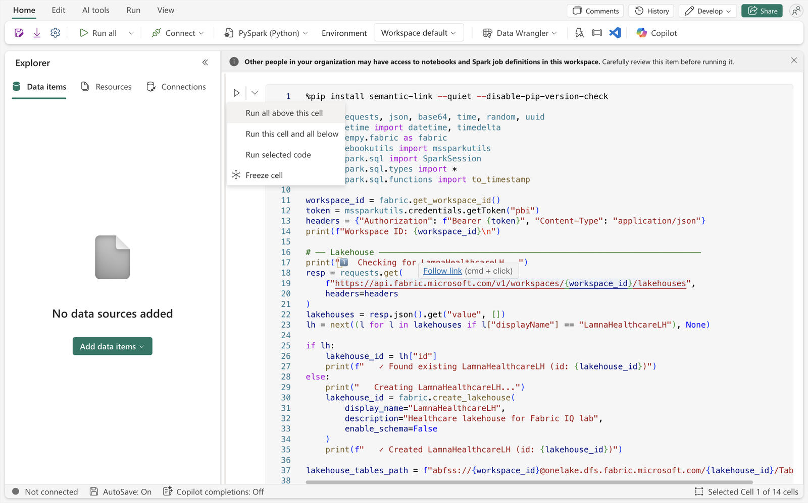
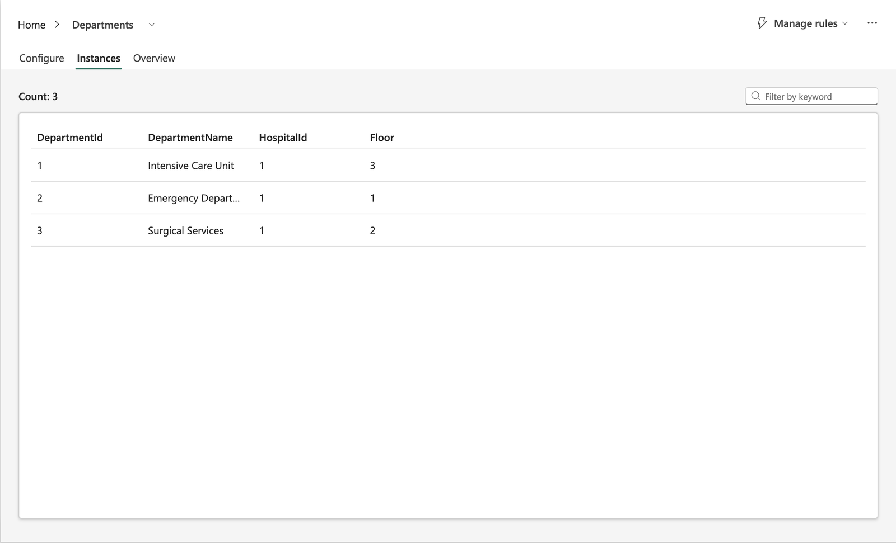
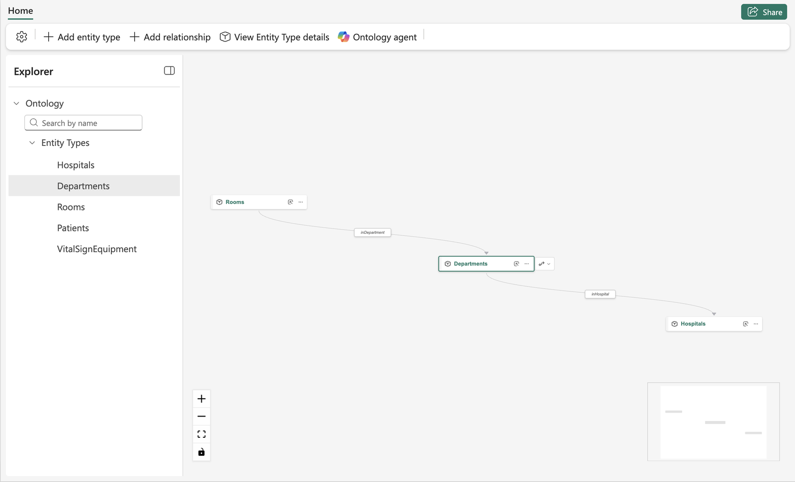
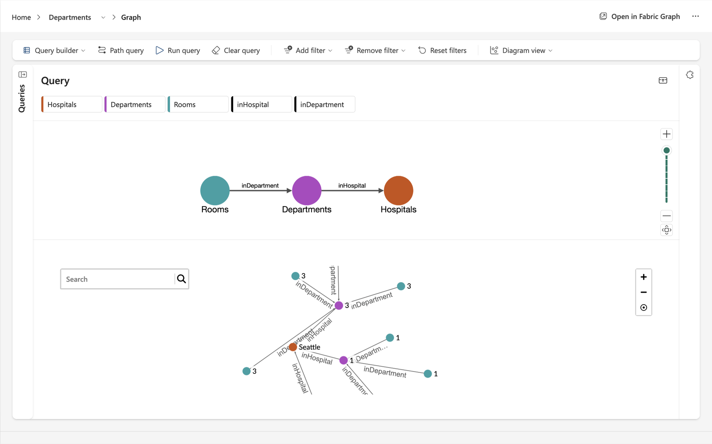
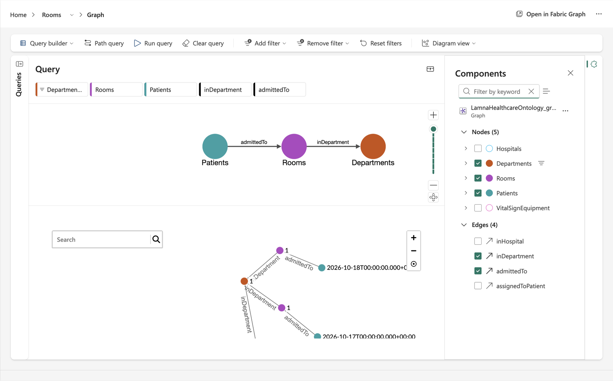
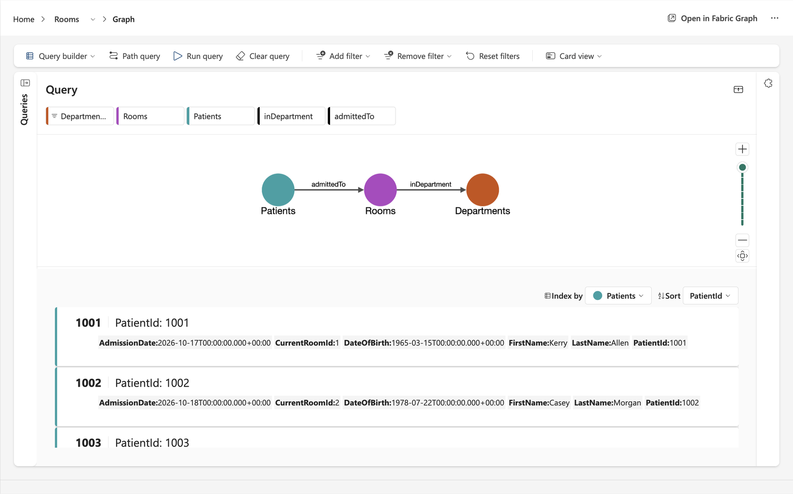

---
lab:
  title: Visualize ontology data with Microsoft Fabric IQ
  module: Visualize ontology data with Microsoft Fabric IQ
  description: In this lab, you visualize entity instances and relationships using the ontology preview experience. You work with the Lamna Healthcare ontology to see how your data comes to life through interactive graphs, charts, and relationship visualizations.
  duration: 30 minutes
  level: 100
  islab: true
  primarytopics:
    - Microsoft Fabric
  categories:
    - Fabric IQ
  courses:
---

# Visualize ontology data with Microsoft Fabric IQ

In this lab, you'll create an ontology from a notebook for a fictitious company called Lamna Healthcare. You'll visualize entity instances, explore entity relationships through interactive graphs, and see your data through property charts and time-series visualizations.

> [!IMPORTANT]
> Ontology in Microsoft Fabric is currently in [preview](https://learn.microsoft.com/fabric/fundamentals/preview).

This lab takes approximately **30** minutes to complete.

> **Note**: You need access to a Fabric paid or trial capacity to complete this exercise. For information about the free Fabric trial, see [Fabric trial](https://aka.ms/fabrictrial). You'll also need to enable the following [tenant settings](https://learn.microsoft.com/fabric/iq/ontology/overview-tenant-settings): **Users can create Fabric items** and **Users can create ontology (preview) items**.

## Create a workspace

1. Navigate to the [Microsoft Fabric home page](https://app.fabric.microsoft.com/home?experience=fabric) in a browser, and sign in with your Fabric credentials.
1. In the menu bar on the left, select **Workspaces** (the icon looks similar to &#128455;).
1. Create a new workspace with a name of your choice, selecting a licensing mode that includes Fabric capacity (*Fabric* or *Trial*).
1. When your new workspace opens, it should be empty.

## Create the ontology from a notebook

This lab focuses on visualizing an ontology using the preview experience—examining entity instances, exploring relationships in the graph, and filtering data using the Query builder. To maximize your time working with these features, you'll use a notebook that automates the ontology creation process, including setting up the lakehouse, eventhouse, entity types, data bindings, and relationships.

The Lamna Healthcare ontology includes sample data representing hospitals, departments, rooms, patients, vital sign equipment, and vital signs readings.

> **Note**: If you want to learn how to build ontologies step-by-step, see the exercises on [creating an ontology manually](https://microsoftlearning.github.io/mslearn-fabric/Instructions/Labs/23-build-ontology-manually.html) or [generating an ontology from a semantic model](https://microsoftlearning.github.io/mslearn-fabric/Instructions/Labs/24-build-ontology-semantic-model.html).

1. Select [**setup-ontology.ipynb**](https://github.com/MicrosoftLearning/mslearn-fabric/raw/main/Allfiles/Labs/27-28/setup-ontology.ipynb) to open the notebook file in your browser, then right-click and save it to your local computer. If your browser saves it as `setup-ontology.ipynb.txt`, rename the file to remove the `.txt` extension.

1. In your workspace, select **Import** > **Notebook** > **From this computer** from the toolbar.

1. In the **Import status** pane:
   - Select **Upload** and browse to the **setup-ontology.ipynb** file you downloaded
   - Select **Open**

1. Wait for the import to complete. The notebook appears in your workspace item list.

1. Select the **setup-ontology** notebook to open it.

   The notebook contains detailed markdown cells explaining each step. It will:
   - Create a lakehouse named **LamnaHealthcareLH** with 5 hospital data tables (Hospitals, Departments, Rooms, Patients, VitalSignEquipment)
   - Create an eventhouse named **LamnaHealthcareEH** with time-series vital signs readings
   - Build the **LamnaHealthcareOntology** with 5 entity types, data bindings, and relationship types via the Fabric REST API

1. In the notebook, locate the first Python code cell under **Step 0: Get or Create Infrastructure**. To the left of the cell, select **Additional commands** (**&hellip;**), and then select **Run this cell and all below**.

   

### What to expect when the notebook runs

As the notebook executes, watch for these success indicators in the cell outputs:

- **Step 0**: Displays "✅ Infrastructure ready!" with lakehouse and eventhouse IDs
- **Step 1**: Shows "✅ All lakehouse tables written!" with a count of 5 tables
- **Step 2**: Confirms "✅ Eventhouse step complete!" after ingesting 15 readings
- **Step 3**: Reports "✅ Entity and relationship definitions ready!"
- **Step 4**: After polling, displays "✅ SUCCESS" (this step creates the ontology via REST API)
- **Step 5**: Lists "Ontologies in workspace:" with your ontology name marked with ✅

> **Troubleshooting**: If Step 4 shows "❌ FAILED", the notebook will display error details. Common causes include insufficient permissions or missing tenant settings. Verify you have the required tenant settings enabled and try re-running the notebook. If you see "Name not available yet — retrying in 30 seconds...", the notebook is waiting for a previously deleted ontology name to be released. This is expected when you re-run the notebook, and the notebook retries automatically.
>
> If a cell fails with a `TooManyRequestsForCapacity` (HTTP 430) error, another Spark session is using your capacity. Stop any other running notebook sessions, and then run the cell again.

1. When execution finishes, verify the following items appear in your workspace:
   - **LamnaHealthcareLH** (lakehouse, with its SQL analytics endpoint)
   - **LamnaHealthcareEH** (eventhouse, with its KQL database)
   - **LamnaHealthcareOntology** (ontology)
   - **LamnaHealthcareOntology_graph_*&lt;id&gt;*** (graph model) — automatically created for the ontology
   - **LamnaHealthcareOntology_lh_*&lt;id&gt;*** (lakehouse, with its SQL analytics endpoint) — automatically created for the ontology

   > **Important**: After the notebook completes, Fabric processes the data bindings and builds the graph model in the background. **This processing typically completes in a few minutes**, depending on capacity load and complexity. This is a one-time setup process—once complete, the ontology remains responsive. To check if data is ready, open the **LamnaHealthcareOntology** item, select an entity type (e.g., **Departments**), select **View Entity Type details** in the ribbon, and then select the **Instances** tab. If you see "Setting up Graph child artifact" on the **Overview** tab, wait on the page and refresh it after a few minutes. Once entity instances appear, you can continue to the next section.

   

> **Note**: The ontology opens in the current ontology experience, and a banner offers to create a copy in the new experience. Dismiss the banner and continue with this exercise in the current experience.

Now you're ready to explore the ontology.

## Explore entity instances

Now that your ontology is built and the data has loaded, you can explore the entity instances—the actual data records from your lakehouse and eventhouse that populate each entity type.

### View the Departments entity instances

You may already have the **Departments** entity type open from checking if the data loaded. If you navigated away:

1. Return to the **LamnaHealthcareOntology** ontology canvas
1. Select the **Departments** entity type to highlight it
1. In the ribbon, select **View Entity Type details**

   

Once in the entity type overview:

The entity type details page has three tabs: **Configure**, **Instances**, and **Overview**.

1. Select the **Overview** tab. It shows several tiles:
   - A **Relationship graph** tile showing how Departments connects to other entity types
   - A **Resource links** tile (empty in this exercise, because no links are configured)
   - **Property chart tiles** visualizing the distribution of property values across the department records:
     - **DepartmentName**: Shows the three department names in your data
     - **HospitalId**: Shows which hospital the departments belong to (all departments belong to HospitalId 1)
     - **Floor**: Shows the floor numbers where each department is located (floors 1, 2, and 3)

1. Observe how the property chart tiles provide a visual summary of your data before drilling into individual records.

1. Select the **Instances** tab. This tab lists the actual department records from the lakehouse.

1. Verify you can see department records such as *Intensive Care Unit*, *Emergency Department*, and *Surgical Services*.

1. Select any row in the table (for example, *Intensive Care Unit*).
1. The **Instance view** opens, showing:
   - All property values for the selected department instance
   - A **Relationship graph** tile for the instance
   - The same property chart tiles you saw on the **Overview** tab

1. In the breadcrumb at the top of the page, select **Departments** to return to the Departments entity type details.

### Explore time-series data from the eventhouse

The VitalSignEquipment entity is bound to your eventhouse for time-series data. Unlike the lakehouse entities you explored earlier (Departments, Hospitals), which contain relatively static records, the eventhouse stores continuously streaming vital signs readings—measurements captured at specific timestamps that change frequently.

Here's how static and time-series data connect in this ontology:
- **VitalSignEquipment** (static): Each equipment record in the lakehouse has properties like EquipmentId, PatientId, and MonitoringStartDate that rarely change
- **VitalSignsReadings** (time-series): The measurements from that equipment—heart rate, oxygen saturation, respiratory rate—are captured at regular intervals in the eventhouse and associated with an equipment record

This combination lets you see both the equipment details and its real-time readings in one unified view. The **Overview** tab displays time-series charts showing how these measurements change over time.

1. In the breadcrumb, select **Home** to return to the ontology canvas, and then select the **VitalSignEquipment** entity type.
1. In the ribbon, select **View Entity Type details**, and then select the **Overview** tab.
1. Notice that this entity type displays differently than lakehouse-bound entities:
   - **Time-series charts** show measurements over time (HeartRate, OxygenSaturation, RespiratoryRate) in addition to the standard property distribution charts (PatientId, EquipmentType)
   - The time range selector at the top (the button labeled **Last 30 days - 1 hour - Average**) controls what time period is displayed in the time-series charts

1. The sample data is timestamped for the 30 minutes before you ran the setup notebook. To view the detailed time-series charts, select the time range button at the top, and then configure the following settings:
   - **Time range**: Select **Last 3 days**
   - **Time granularity**: Select **5 minutes**
   - **Aggregation**: Select **Average**

1. Select **Apply**.

1. Observe the time-series charts showing vital sign readings (heart rate, oxygen saturation, respiratory rate) with data points at 5-minute intervals.

1. Select the **Instances** tab, and then select an equipment ID (for example, **VS-1004**) to view the specific readings in the **HeartRate**, **OxygenSaturation**, and **RespiratoryRate** tiles.

1. In the breadcrumb, select **Home** to return to the ontology canvas when you are finished exploring.

## Visualize the relationship graph

The ontology relationship graph lets you see how entity types connect to each other and navigate through multi-hop relationships. Next, you'll expand the graph from the Department entity and explore connections across your healthcare model.

### Expand and explore the graph

1. On the ontology canvas, select the **Departments** entity type.
1. Select **View Entity Type details** from the ribbon, and then select the **Overview** tab.
1. In the **Relationship graph** tile, select **Expand**.
1. The graph view opens, showing entity type nodes (not actual data instances yet).
1. Select **Run query** from the ribbon.
1. The graph at the bottom of the screen now loads actual entity instances from your bound data. The first query can take a minute or two to finish:
   - Entity type nodes expand into clusters of individual instances
   - Edges show labeled relationship connections between instances (inHospital, inDepartment).
   - You can add additional nodes and edges to the canvas by selecting them in the **Components** pane.

   

2. Select the **Hospitals** node (labeled **Seattle**) to view its properties in the side panel.
3. Follow the relationship edges to see how the entities connect:
   - Departments connect to hospitals via **inHospital** edges
   - Rooms connect to departments via **inDepartment** edges
   
   > **Note**: You can zoom and pan in the graph view using your mouse or the controls in the bottom-right corner. Double-click a node to center and zoom on it.

4. When finished exploring, select **Departments** in the breadcrumb at the top of the page to leave the graph view.

## Filter data with the Query builder

The Query builder lets you filter and shape the data you retrieve from the ontology graph. You'll create two filtered views: one to find patients in a specific department, and another that uses the **Add a node** feature to include monitoring equipment in your results.

### Find patients in the Intensive Care Unit department

1. In the breadcrumb, select **Home** to return to the ontology canvas. Select the **Rooms** entity type, select **View Entity Type details** in the ribbon, and then select the **Overview** tab. Select **Expand** on the **Relationship graph** tile to open the graph view.
1. In the **Query builder** ribbon, select **Add filter**.
1. In the menu, select **Departments**, and then select **DepartmentName**.
1. In the **Filter** dialog, configure the filter:
   - **For**: Departments
   - **Where**: DepartmentName
   - **Operator**: **=**
   - **Value**: Intensive Care Unit

1. Select **Apply**.

2. Select the **Components** icon on the right side of the query builder to open the **Components** pane. Verify that only the following items are checked (these are selected by default when you start from the **Rooms** entity type):
   - **Nodes**: Departments, Rooms, Patients
   - **Edges**: inDepartment, admittedTo
   - If any other nodes or edges are checked, uncheck them.

   

3. Select **Run query**. The query can take a minute to finish.
4. The graph now shows only:
   - The Intensive Care Unit department instance
   - Rooms that belong to ICU (inDepartment relationship)
   - Patients admitted to those rooms (admittedTo relationship)

5. Above the graph visualization, locate the **Diagram view** mode selector and explore the three result views:
   - **Diagram view**: Interactive graph structure (current view)
   - **Card view**: Property values displayed as cards for each instance
   - **Table view**: Tabular rows and columns format

6. Switch to **Card view**. The cards are initially grouped by **Rooms**.
   - Notice the **Index by** dropdown above the cards. This lets you organize the cards by different entity types in your query results.
   - Select **Patients** from the dropdown to see each patient's details displayed in individual cards.
   - Try selecting **Departments** or **Rooms** from the dropdown to see how the data reorganizes around that entity type.

   
   
7. Switch to **Table view** to see a spreadsheet-like format of your query results.
8. Return to **Diagram view**.
9. In the ribbon, select **Clear query** to reset the graph.

### Find monitoring equipment for ICU patients

This query demonstrates the **Add a node** feature, which lets you include additional entity types in your query results.

1. In the graph view, you should have a cleared query from the previous step.
1. In the **Query canvas**, select **Add a node**. The available entity types appear around the **Add a node** button.
1. Select **VitalSignEquipment**. This adds VitalSignEquipment to your query canvas.

   > **Note**: Adding a node only includes that specific entity type in your query. To see how VitalSignEquipment connects to patients, rooms, and departments, you need to select additional components.

1. Open the **Components** pane (if not already open). Notice that only **VitalSignEquipment** is checked under **Nodes**, and no **Edges** (relationships) are selected.

1. In the **Components** pane, add the other entity types and relationships needed to connect VitalSignEquipment back to departments:
   - **Nodes**: Select: Departments, Rooms, and Patients (VitalSignEquipment is already checked)
   - **Edges**: Select: inDepartment, admittedTo, and assignedToPatient

1. Select **Add filter**, select **Departments** and then **DepartmentName**, and then configure the filter:
   - **For**: Departments
   - **Where**: DepartmentName
   - **Operator**: **=**
   - **Value**: Intensive Care Unit

1. Select **Apply**, and then select **Run query**.
1. The result now includes the complete chain from ICU department through rooms and patients to their vital sign monitoring equipment. Switch to **Card view**, and use the **Index by** dropdown to select **VitalSignEquipment**.
1. Review the cards for each **VitalSignEquipment** instance to see its properties, including the patient it monitors (**PatientId**) and when monitoring began (**MonitoringStartDate**).

## Clean up resources

If you're finished exploring Fabric IQ ontologies, you can delete the workspace you created for this exercise.

1. In the bar on the left, select the icon for your workspace.
1. In the toolbar, select **Workspace settings**.
1. In the **General** section, select **Remove this workspace**.
1. Select **Delete** to confirm deletion.

## Summary

In this exercise, you explored the Lamna Healthcare ontology to understand how bound data populates entity types. You:

- Examined entity instances in the overview page and instance view
- Explored time-series data from the eventhouse with date range filtering
- Visualized multi-hop relationships in the graph (Departments → Rooms → Patients → VitalSignEquipment)
- Filtered data using the Query builder and Components pane
- Used the Add a node feature to extend your filtered views

These visualization capabilities let you explore your business data through the lens of the ontology model, following relationships across multiple data sources without writing complex queries.